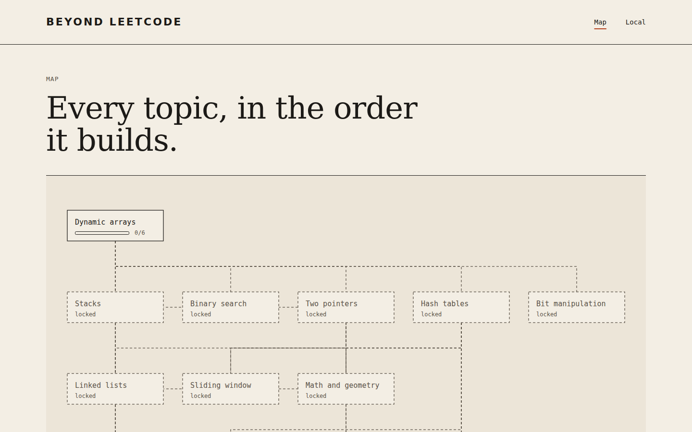
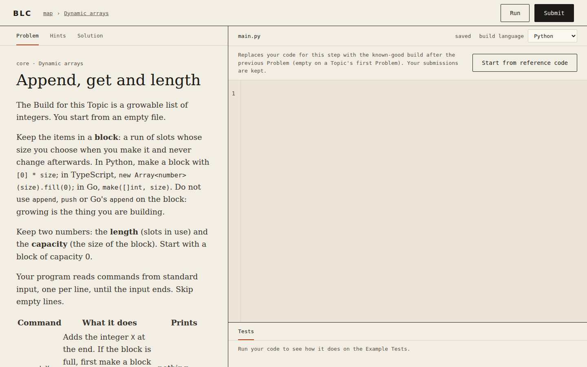

<picture>
  <source media="(prefers-color-scheme: dark)" srcset="docs/assets/logo-dark.svg">
  
</picture>

[](https://github.com/GauranshMathur/BeyondLeetcode/actions/workflows/ci.yml)
[](https://github.com/GauranshMathur/BeyondLeetcode/releases)
[](LICENSE)

You learn data structures and algorithms by Topic. Each Topic's Chapters read a real system's source at a pinned version, and each Problem is a step in a Build, not a puzzle. Every claim is cited to a primary source (see the [content standards](docs/content-standards.md)). It is self-hosted and free, for one learner (Local Mode) or a group (Multi-user).

<p>
  <picture>
    <source media="(prefers-color-scheme: dark)" srcset="docs/assets/screenshots/map-dark.png">
    
  </picture>
</p>
<p>
  <picture>
    <source media="(prefers-color-scheme: dark)" srcset="docs/assets/screenshots/problem-dark.png">
    
  </picture>
</p>

## Quick start

You need Docker with Compose. `init` writes `compose.yaml` and `.env` into the folder you mount; `--origin` is the URL you will open the app at.

```sh
mkdir beyondleetcode && cd beyondleetcode
docker run --rm -v "$PWD":/out ghcr.io/gauranshmathur/beyondleetcode init --origin http://localhost:3000
docker compose up -d
```

Open <http://localhost:3000>, go to Setup and choose Local.

> Local Mode has no login, so keep it on your own machine.

Safety notes, Multi-user, upgrading and recovery are in [docs/self-hosting.md](docs/self-hosting.md).

## Topics

<!-- topics:start -->
| # | Topic | Chapters | Problems |
|--:|---|--:|--:|
| 1 | Dynamic arrays | 3 | 6 + 1 |
| 2 | Stacks | 4 | 9 + 0 |
| 3 | Binary search | 4 | 7 + 0 |
| 4 | Two pointers | 4 | 10 + 3 |
| 5 | Hash tables | 4 | 9 + 0 |
| 6 | Linked lists | 5 | 12 + 2 |
| 7 | Sliding window | 4 | 8 + 2 |
| 8 | Math and geometry | 4 | 8 + 4 |
| 9 | Bit manipulation | 4 | 10 + 2 |
| 10 | Trees | 5 | 9 + 2 |
| 11 | Backtracking | 5 | 6 + 4 |
| 12 | Tries | 4 | 6 + 2 |
| 13 | Heaps | 5 | 7 + 2 |
| 14 | 1-D dynamic programming | 4 | 6 + 3 |
| 15 | Greedy | 4 | 4 + 2 |
| 16 | 2-D dynamic programming | 4 | 5 + 5 |
| 17 | Graphs | 5 | 10 + 4 |
| 18 | Intervals | 4 | 4 + 3 |
| | **Total** | **76** | **136 + 41** |
<!-- topics:end -->

## How it works

The map is a set of Topics that unlock in order. A Topic holds Chapters, each about a real system and the data structure decision it made. A Chapter has Problems, solved in the browser against real tests, each one adding to a Build.

## Repo map

- `src/`: the app (SvelteKit). Server modules are in `src/lib/server/`, see [docs/module-map.md](docs/module-map.md).
- `content/`: the Topics, Chapters, Problems and tests a learner reads and solves.
- `docs/`: product decisions ([MVP1](docs/product/mvp1.md)), [content standards](docs/content-standards.md), [ADRs](docs/adr/), [releasing](docs/releasing.md), [self-hosting](docs/self-hosting.md).
- `scripts/`: repo tooling, such as the Topics table script and the screenshot capture.
- `static/`: static assets served by the app.
- `.github/`: CI, release workflows and CI helper scripts.
- `playwright.config.ts`, `playwright.smoke.config.ts`, `playwright.screenshots.config.ts`: end-to-end tests, the smoke test, and the README screenshots. Regenerate the screenshots with `npx playwright test -c playwright.screenshots.config.ts`.

## Contributing

**Content** (a new Chapter, Problem or Topic) goes: open an [issue](https://github.com/GauranshMathur/BeyondLeetcode/issues), it becomes a card on the board, then a PR written to the [content standards](docs/content-standards.md), with every link in the human review queue. After adding a Topic, run `bun scripts/readme-topics.ts` to refresh the Topics table above.

**Code** goes through the [project board](https://github.com/users/GauranshMathur/projects/1); see [docs/agents/board.md](docs/agents/board.md). Read the [MVP1 decisions](docs/product/mvp1.md) first, and [docs/releasing.md](docs/releasing.md) for how releases are cut. Screens are designed in the [design canvas](https://claude.ai/artifact/WRJr84ccDYXAd3Yg1Xvp1d), with every screen in light and dark.

## License

[MIT](LICENSE)
